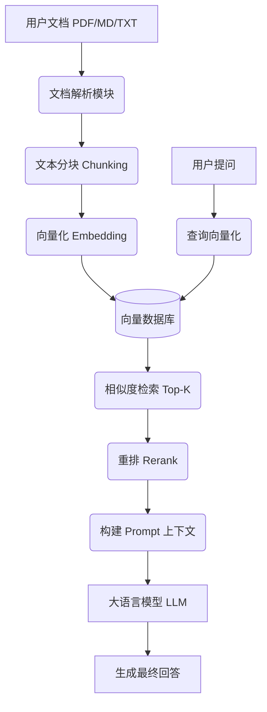

# 系统架构

本页介绍 RAG Tech Docs 的整体架构设计、核心模块以及数据流转过程，帮助你理解系统是如何从文档输入一步步生成准确回答的。

## 整体架构图

本系统采用经典的 **RAG（检索增强生成）** 架构。整体数据流如下：

## 核心模块拆解

### 1. 数据摄入层 (Document Ingestion)
负责将非结构化文档转化为机器可检索的向量数据。
- **文档解析**：支持 PDF、Markdown、TXT 等格式，提取纯文本内容。
- **文本分块（Chunking）**：将长文档切分为语义完整的短片段（Chunk），以适配大模型的上下文窗口限制。
- **向量化（Embedding）**：调用 Embedding 模型将文本块转化为高维向量。

### 2. 向量存储层 (Vector Storage)
- **向量数据库**：用于存储文档向量及其元数据（如文件名、页码、创建时间）。本项目默认支持 Chroma，也可扩展至 Milvus、Qdrant 等。
- **索引机制**：通过近似最近邻（ANN）算法，实现毫秒级的相似度检索。

### 3. 检索层 (Retrieval)
- **相似度检索**：将用户问题转化为向量，在向量数据库中检索出最相似的 Top-K 个文本块。
- **重排（Rerank，可选）**：使用交叉编码器（Cross-Encoder）对初步检索结果进行二次精排，提升相关性。
- **混合检索（Hybrid Search，规划中）**：结合关键词检索（BM25）与向量检索，兼顾语义与精确匹配。

### 4. 生成层 (Generation)
- **Prompt 构建**：将检索到的上下文与用户问题组合，填入预设的 Prompt 模板。
- **LLM 调用**：支持 OpenAI 接口规范，可无缝切换 GPT-3.5、GPT-4 或国内大模型（如通义千问）。
- **流式输出**：支持 SSE（Server-Sent Events）流式返回，提升用户体验。

## 技术选型

| 模块 | 技术选型 | 说明 |
| :--- | :--- | :--- |
| 后端框架 | FastAPI | 高性能异步框架，自动生成 OpenAPI 文档 |
| 文档解析 | LangChain / Unstructured | 处理各类非结构化文档 |
| 向量数据库 | Chroma (默认) | 轻量级、易部署，适合本地开发 |
| 大模型接口 | OpenAI SDK | 兼容 OpenAI 格式的各类模型 |
| 前端 Demo | React / Docusaurus | 提供交互式问答界面 |

## 扩展性设计

本系统采用模块化设计，各层之间通过接口解耦。你可以轻松替换任意组件：
- **更换向量库**：修改 `VectorStore` 接口的实现即可。
- **更换 Embedding 模型**：修改配置中的模型名称。
- **更换 LLM**：只需修改 `.env` 中的 `OPENAI_BASE_URL` 和 `MODEL_NAME`。

:::tip 提示
如果你对 RAG 的底层原理感兴趣，请深入阅读 [RAG 流程解析](../05-原理与最佳实践/rag-pipeline.md)。
:::
