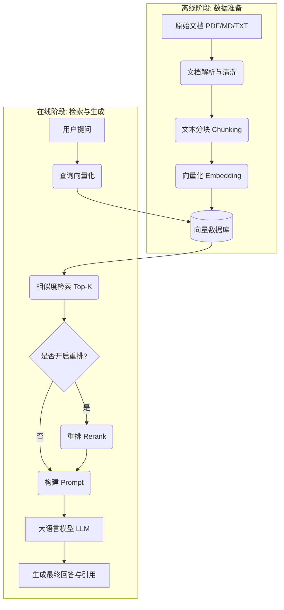

# RAG 流程解析

本页深入解析 RAG（检索增强生成）系统的底层工作流程。理解这个流程，有助于你在后续调优时，准确判断问题出在哪个环节。

## 为什么需要 RAG？

大语言模型（LLM）的知识被冻结在训练数据截止的那一刻，并且无法直接访问你的私有数据。RAG 的核心思想是：**在生成回答之前，先去你的知识库中“查资料”**，把查到的资料作为上下文，一并交给大模型生成答案。

这带来了三大优势：
1. **减少幻觉**：模型基于真实文档回答，而非凭空捏造。
2. **数据私有**：你的文档始终存放在自己的向量数据库中。
3. **实时更新**：上传新文档即可立即生效，无需重新训练模型。

## 完整流程拆解

1. RAG 的完整流程可以分为**离线的数据准备**和在线的**检索与生成**两个阶段。

2. RAG系统架构图

```mermaid
flowchart LR
    %% 定义节点样式
    classDef process fill:#fff,stroke:#333,stroke-width:2px;
    classDef document fill:#f9f9f9,stroke:#333,stroke-width:2px;
    classDef model fill:#e1f5fe,stroke:#0288d1,stroke-width:2px;
    classDef db fill:#fff3e0,stroke:#f57c00,stroke-width:2px;
    classDef llm fill:#f3e5f5,stroke:#7b1fa2,stroke-width:2px;

    %% 数据准备阶段（上半部分，从左到右）
    subgraph Data_Preparation [数据准备阶段]
        direction LR
        Doc[本地文件<br/>可以是结构化数据（二维表）<br/>非结构化文本（PDF、Word、TXT等格式）]:::document
        Loader[非结构化数据加载器<br/>Unstructured Loader]:::process
        Text[Text]:::process
        Splitter[文本切分<br/>Text Splitter]:::process
        Chunk[Text Chunk]:::process
        EmbedModel1[嵌入模型<br/>Embedding Model]:::model
        VecEmbed1[向量嵌入<br/>Vector Embeddings]:::process
        
        Doc --> Loader
        Loader --> Text
        Text --> Splitter
        Splitter --> Chunk
        Chunk --> EmbedModel1
        EmbedModel1 -->|转换为| VecEmbed1
    end

    %% 向量数据库（跨阶段连接）
    VectorDB[(向量数据库<br/>Vector Database)]:::db

    %% 检索与生成阶段（下半部分，同样横向流动）
    subgraph Retrieval_Generation [检索与生成阶段]
        direction LR
        UserQuery[User Query]:::process
        EmbedModel2[嵌入模型<br/>Embedding Model]:::model
        VecEmbed2[向量嵌入<br/>Vector Embeddings]:::process
        
        SimilarSearch[向量数据库中的相似向量<br/>作为上下文Context]:::process
        PromptTemplate[提示词模板<br/>Prompt Template]:::process
        Prompt[提示词Prompt<br/>Prompt = Context + User Query]:::process
        LLM[LLM]:::llm
        Answer[回答<br/>Answer]:::process
        
        UserQuery --> EmbedModel2
        EmbedModel2 -->|转换为| VecEmbed2
        VecEmbed2 -->|相似度搜索<br/>Similarity Search| SimilarSearch
        SimilarSearch --> PromptTemplate
        PromptTemplate --> Prompt
        Prompt -->|提问| LLM
        LLM --> Answer
        Answer -.->|发送给用户| UserQuery
    end

    %% 连接数据准备和向量数据库
    VecEmbed1 -->|存储 & 索引<br/>Store & Index| VectorDB
    VectorDB -.->|检索| SimilarSearch

    %% 调整布局样式
    linkStyle default stroke:#333,stroke-width:2px;
```

## 各阶段详解

### 1. 文档解析与清洗
将非结构化文档转化为纯文本。需要处理 PDF 中的表格、页眉页脚、图片文字等。清洗的目的是去除噪音，提升后续向量化的质量。

### 2. 文本分块（Chunking）
将长文档切分为语义完整的短片段。这是因为大模型的上下文窗口有限，且过长的文本会稀释语义。详细策略请参考 [分块策略](chunking.md)。

### 3. 向量化（Embedding）
使用 Embedding 模型将每个文本块映射到一个高维向量空间。语义相近的文本，在向量空间中的距离也更近。

### 4. 相似度检索
将用户问题也转化为向量，在向量数据库中计算与所有文本块的相似度（通常使用余弦相似度），返回最相似的 Top-K 个片段。

### 5. 重排（Rerank）
向量检索是“粗排”，速度快但精度有限。重排模型（Cross-Encoder）会将问题和候选片段拼接后一起输入，进行更精细的相关性打分。虽然速度慢，但精度显著提升。

### 6. 构建 Prompt 与生成
将检索到的片段拼接成上下文，填入预设的 Prompt 模板，连同用户问题一起发送给 LLM。LLM 根据这些上下文生成最终回答。

## 常见的失效点与排查思路

| 现象 | 可能出错的阶段 | 排查方向 |
| :--- | :--- | :--- |
| 回答“我不知道” | 检索阶段 | 检查分块大小、相似度阈值、是否开启重排 |
| 回答偏离主题 | 生成阶段 | 检查 Prompt 模板，限制模型只依据上下文回答 |
| 回答包含幻觉 | 检索 + 生成 | 提高检索质量，在 Prompt 中强调“不知道就说不知道” |
| 检索到无关内容 | 向量化阶段 | 检查 Embedding 模型是否适合中文/专业领域 |

## 下一步

- 想深入了解分块策略？请查看 [分块策略](chunking.md)。
- 想知道如何评估效果？请查看 [效果评估](evaluation.md)。
